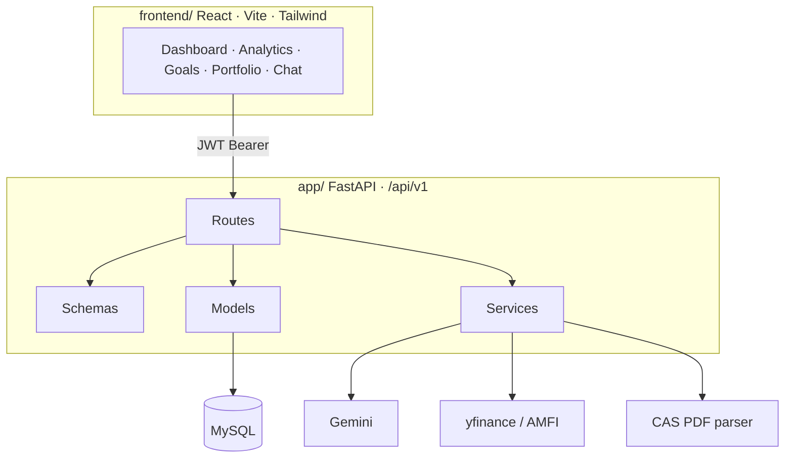

# Capitallens

**See your money. Trust the advice.**

[](https://fastapi.tiangolo.com)
[](https://react.dev)
[](https://www.mysql.com)
[](https://www.python.org)
[](https://jwt.io)
[](https://ai.google.dev)

Spreadsheets show what you typed. Bank apps show what they want you to buy. Capitallens is the layer in between: **your** ledger, **your** goals, **your** portfolio — with analytics and an advisor that is not allowed to ignore an empty emergency fund.

```
  You log income, expenses, goals, holdings
                    │
                    ▼
     Capitallens aggregates, values, and scores risk
                    │
                    ▼
     You see runway, charts, and capped AI suggestions
```

Local app → [http://localhost:5173](http://localhost:5173) · API docs → [http://localhost:8000/docs](http://localhost:8000/docs)

---

## The problem

Most “money apps” either dump a chatbot on raw balances or hide everything behind a bank. Neither is useful in an interview — or in real life.

- A model that says “invest ₹2L” when you have ₹30k and no emergency buffer is a **liability**.
- A dashboard that cannot answer “what did September look like, day by day?” is a **spreadsheet with extra steps**.
- A portfolio that is not tied back to the cash ledger **double-counts** wealth.

Capitallens is built so numbers are **owned by the user**, **scoped by JWT**, and **guarded in code** before any LLM speaks.

---

## What it does

| | Capability | How it actually works |
| --- | --- | --- |
| 📒 | **Ledger** | Income / expense CRUD, filters, ownership on every query (`user_id` from the token, never the body) |
| 🎯 | **Goals** | Target vs saved, add / withdraw with a contribution log (positive and negative amounts) |
| 📊 | **Analytics** | Lifetime vs this-month vs last-month, category mix, 6-month trend, day / month / year / custom range charts |
| 📈 | **Portfolio** | Live prices (Yahoo / AMFI) with formula fallback (FD, PPF, real estate CAGR) |
| 📄 | **CAS import** | CAMS / KFin / NSDL PDF → mutual funds and stocks (no password scraping of portals) |
| 🛡️ | **Suggestions** | Risk score + **hard cash cap in Python**, then Gemini (or mock) for exactly 3 options |
| 💬 | **Chat** | Tab-aware advisor on a live snapshot (totals, goals, holdings, last 120 txns), PII-masked |

---

## Product surfaces

| Surface | What you get | Status |
| --- | --- | --- |
| Landing + auth | Register / login, JWT in `localStorage` | ✅ |
| Dashboard | Income, burn, savings rate, runway, locked vs available cash | ✅ |
| Transactions | Full ledger + add modal | ✅ |
| Analytics | Category, trends, flexible `range` engine | ✅ |
| Savings | Goals, progress, contribution history | ✅ |
| Investments | Portfolio, redeem, live price, CAS upload, AI suggestions | ✅ |
| Copilot / chat | Context from the open tab + action / chart / table tags | ✅ |

---

## Why the AI is not “just Gemini”

Logging income into a prompt and hoping for SEBI-quality advice is how demos fail reviews.

**Suggestions** (`GET /investments/suggestions`)

1. Build a snapshot: savings, runway, emergency target (named goals, else ~3 months of spend).
2. Score risk in **code** (runway, savings rate, income stability, emergency coverage) → Conservative / Moderate / Aggressive, with safety brakes.
3. **Cap investable cash** before the model runs. Incomplete emergency fund → 20% of savings, max ₹15,000. Critical runway → 10%, max ₹5,000. Healthy buffer → unallocated cash minus the emergency reserve.
4. Gemini (or a profile-aligned mock if there is no API key) returns **three** ideas whose allocations **sum to that cap**.
5. Tickers can be enriched with historical CAGR.

**Chat** (`POST /ai/chat`) retrieves the user’s data first (RAG-style inject), steers by `active_tab`, masks emails / phones / long numbers, and degrades to a local fallback if Gemini is down. Chat history is sent by the client; this route does not persist threads.

The model writes copy. **Limits are not negotiable in the prompt.**

---

## Architecture



**Stack:** FastAPI + SQLAlchemy + Pydantic · MySQL 8 · React 19 + Vite · JWT · Gemini Flash (optional) · yfinance / AMFI.

No Gemini key? The app still runs: ledger, goals, analytics, portfolio formulas, and **mock** suggestions / chat fallback. It degrades. It does not crash.

| Layer | Responsibility |
| --- | --- |
| `app/routes` | HTTP, auth dependency, user-scoped queries |
| `app/schemas` | Validation (amounts, dates, enums) |
| `app/models` | Tables and relationships |
| `app/services` | LLM, live prices, CAS |
| `app/utils` | Password hash, JWT |
| `frontend/` | Product UI |

Investing writes an `Investment` **expense**; redeeming writes `Investment Return` **income**, so analytics and the portfolio stay on the same ledger.

---

## Quick start

**You need:** Python 3.11+, Node 18+, MySQL 8.

```sql
CREATE DATABASE capitallens CHARACTER SET utf8mb4 COLLATE utf8mb4_unicode_ci;
```

`.env` at the **repo root** (gitignored):

```env
DATABASE_HOST=localhost
DATABASE_PORT=3306
DATABASE_NAME=capitallens
DATABASE_USER=root
DATABASE_PASSWORD=your_mysql_password

SECRET_KEY=replace-with-a-long-random-string
ALGORITHM=HS256
ACCESS_TOKEN_EXPIRE_MINUTES=30

GEMINI_API_KEY=

CORS_ORIGINS=http://localhost:5173,http://127.0.0.1:5173
DEBUG=true
```

`DATABASE_URL` is assembled for you if you omit it.

**API**

```bash
uv sync
uv run uvicorn app.main:app --reload --host 0.0.0.0 --port 8000
```

or

```bash
python -m venv .venv
# Windows: .venv\Scripts\activate
pip install -e .
uvicorn app.main:app --reload --port 8000
```

`GET http://localhost:8000/health` should return healthy. Tables are created on boot.

**UI**

```bash
cd frontend
npm install
npm run dev
```

Open [http://localhost:5173](http://localhost:5173), register, add a transaction. Optional: `VITE_API_URL=http://localhost:8000/api/v1`.

---

## API map

Base path `/api/v1` (plus `/health` and `/`).

<details>
<summary><strong>Auth</strong></summary>

- `POST /auth/register`
- `POST /auth/login` — OAuth2 form; `username` is email

</details>

<details>
<summary><strong>Transactions</strong></summary>

- `POST /transactions` · `GET /transactions` (`type`, `category`, `limit`)
- `GET | PUT | DELETE /transactions/{id}`
- `GET /transactions/summary/all`

</details>

<details>
<summary><strong>Savings</strong></summary>

- `POST /savings` · `GET /savings` · `GET | PUT | DELETE /savings/{id}`
- `POST /savings/{id}/add-money` · `POST /savings/{id}/withdraw`
- `GET /savings-summary/all` · `GET /savings/contributions/all`

</details>

<details>
<summary><strong>Analytics</strong></summary>

- `GET /analytics/summary` — runway, trends, locked vs available cash
- `GET /analytics/by-category?scope=month|all`
- `GET /analytics/monthly-trend`
- `GET /analytics/recent`
- `GET /analytics/range?view_mode=day|month|year|custom`
- `GET /analytics/categories`

</details>

<details>
<summary><strong>Investments</strong></summary>

- `GET /investments/portfolio`
- `GET /investments/suggestions`
- `POST /investments` · `PUT | DELETE /investments/{id}`
- `POST /investments/{id}/redeem`
- `GET /investments/live-price`
- `POST /investments/import-cas`

</details>

<details>
<summary><strong>Chat</strong></summary>

- `POST /ai/chat` — `{ "message", "active_tab", "chat_history" }`

</details>

---

## Repository

```
app/
  main.py          App, CORS, routers, /health
  config/          Settings, DB session
  models/          ORM
  schemas/         Pydantic contracts
  routes/          auth · transaction · savings · analytics · investment · chat
  services/        ai · ai_chat · market_data · cas_parser
  utils/           JWT, passwords
frontend/          React product
pyproject.toml
```

| Task | Command |
| --- | --- |
| API | `uv run uvicorn app.main:app --reload --port 8000` |
| UI | `cd frontend && npm run dev` |
| UI build | `cd frontend && npm run build` |

---

## Design choices recruiters actually ask about

- **IDOR:** every get/update/delete filters `id` **and** `user_id`. Missing row looks like 404, not “exists but not yours”.
- **Partial updates:** `model_dump(exclude_unset=True)` so omitted fields are not wiped to `null`.
- **Analytics range:** empty buckets first (so charts don’t skip days), then one query, then Python grouping — day vs month vs year vs custom granularity.
- **Fail closed on AI:** no key or HTTP error → mock / local fallback, same safety numbers.
- **Ledger integrity:** portfolio actions emit transactions so summary cards cannot drift from holdings.

---

Built as a full-stack finance product, not a CRUD tutorial. If you are reviewing this repo, start at `app/routes/investment.py` (suggestions + cap) and `app/routes/analytics.py` (range engine).
